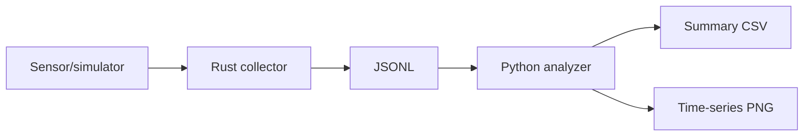

# Capstone: Rust + Python IoT Sensor Pipeline

Rust menghasilkan dan memvalidasi data sensor JSONL. Python membaca record, memvalidasi, menganalisis, lalu menghasilkan CSV dan grafik.

Skema record: `{"timestamp":"2026-01-01T00:00:00Z","device":"ESP32-SIM-01","sensor":"flow","value":12.5,"unit":"L/min"}`.

Kriteria: minimal 100 record, validasi, penanganan JSON rusak, statistik, grafik berlabel, dokumentasi pengujian dan keterbatasan. Generator awal memakai data simulasi, bukan perangkat fisik. Pengembangan berikutnya: ESP32 serial/MQTT, database time-series, dan dashboard.
